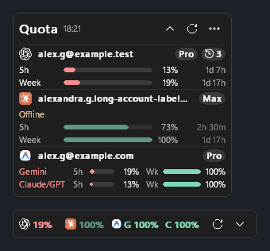
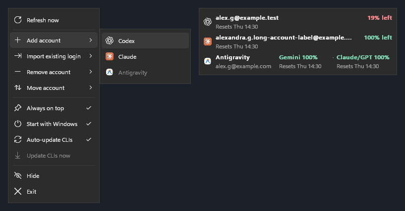

# QuotaGadget

See how much quota you have left across Codex, Claude Code, and Antigravity accounts on one Windows desktop. Each bar shows the percentage **remaining** and the time until the provider resets that window. The gadget refreshes every five minutes, or immediately when you click **Refresh now**.



## Quick start

1. Download `QuotaGadget.exe` from the latest GitHub release. Keep it in a folder where you want it to stay, especially if you enable **Start with Windows**.
2. Double-click the executable on 64-bit Windows. The single Native AOT executable includes the runtime and typically uses about 5–6 MB of private working set in Task Manager.
3. On first launch, QuotaGadget automatically detects and loads existing default Codex, Claude, and Antigravity sign-ins in read-only mode. **Add account** and **Import existing login** are available in the **•••** menu. Use the chevron to collapse the gadget into one row.

## Reading the gadget

- **Account cards** show five-hour and weekly limits where available. Green means at least 50% remains, amber means at least 20% but less than 50%, and red means less than 20%. Hover over a bar for its local reset time. A Codex account with saved limit resets shows a count beside its plan. Hover over the count for expiry dates.
- **Compact mode and the tray flyout** show the weekly remaining quota for each Codex or Claude account and for the Antigravity Gemini (**G**) and Claude/GPT (**C**) pools. They show the five-hour quota when the provider reports no weekly window. Use the mouse wheel or **Tab** to reach accounts beyond the edge of the compact row.
- **Desktop and tray** share the same dark Fluent-style menus. Drag the title to move the gadget or drag account headers to reorder them. **Hide** leaves the gadget in the notification area. Hover over the tray icon for quotas and upcoming resets, click to show or hide the gadget, or right-click for commands.
- **CLI updates** run one provider at a time and skip CLIs detected in use. Codex Desktop and Claude Desktop update their bundled CLIs themselves. Automatic checks are enabled by default, run every 12 hours, and retry in an hour if all eligible CLIs are busy. Clear **Auto-update CLIs** to opt out or choose **Update CLIs now** for a manual check.



## Adding accounts

The gadget can display your default desktop account without a separately installed CLI.

- **Codex Desktop** shares the default Codex sign-in and includes a bundled CLI.
- **Claude Desktop** supplies five-hour and weekly percentages through `plan-usage-history.json` when the default Claude Code credentials are absent. This source uses no cookies and provides no reset times. Open Claude Desktop to refresh a sample older than two hours.
- **Antigravity** uses the `agy` CLI first. If it is unavailable, the gadget reads quota from the local daemon while the IDE is running. Older IDEs may report only a percentage and reset time for each model pool.

To add another account, install the provider’s CLI or use a detected bundled CLI. Choose **Add account**, select a provider, and complete sign-in in your browser. Repeat for each Codex or Claude account. Codex uses an isolated `CODEX_HOME` and Claude uses an isolated `CLAUDE_CONFIG_DIR`, so each keeps its own login. Antigravity has one row for the current account.

To display an existing account, choose **Import existing login**. The gadget reads imported profiles without changing them. If an imported login expires, sign in again with its CLI or desktop app and click **Refresh now**. **Remove account** stops polling the account and removes its cached quota. Its profile stays on disk.

## Local files

| Location | Contents |
| --- | --- |
| `%APPDATA%\QuotaGadget\accounts.json` | Account list and order, profile paths, window position, visibility, and settings |
| `%APPDATA%\QuotaGadget\cache.json` | Last successful quotas, account labels and plans, saved resets, and fetch times. Values older than 15 minutes appear dimmed. |
| `%APPDATA%\QuotaGadget\profiles\<id>\` | CLI credentials for a Codex or Claude sign-in created through **Add account** |

**Start with Windows** controls the `QuotaGadget` entry in the current user’s Windows Run key. A manual launch opens the gadget visibly. A startup launch restores its last visibility.

## Build from source

Install the x64 .NET 8 SDK, Visual Studio 2022 C++ Build Tools with **Desktop development with C++**, and the Windows SDK. From an x64 Developer PowerShell at the repository root, run the following commands.

```powershell
dotnet build -c Release -warnaserror
dotnet test -c Release --no-build
dotnet publish src/QuotaGadget -c Release -r win-x64 -o dist -warnaserror
.\dist\QuotaGadget.exe
```

The full test suite exercises the Windows desktop and Explorer taskbar. On a headless Windows runner, use `dotnet test -c Release --no-build --filter "Category!=Interactive"`.

## Disclaimer

QuotaGadget uses unofficial, undocumented provider endpoints that can change. It is an independent project with no affiliation with OpenAI, Anthropic, or Google.
Product names and logos are trademarks of their respective owners (OpenAI, Anthropic, and Google).

## License

[MIT License](LICENSE)

## Credits

Built by Taoming Guo with Antigravity and OpenAI Codex.
